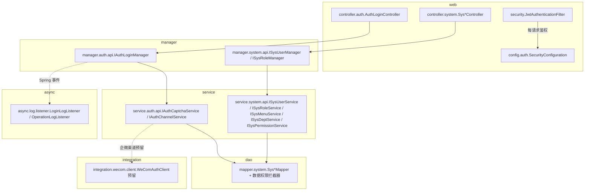
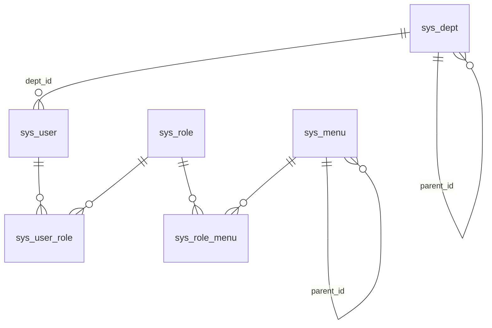
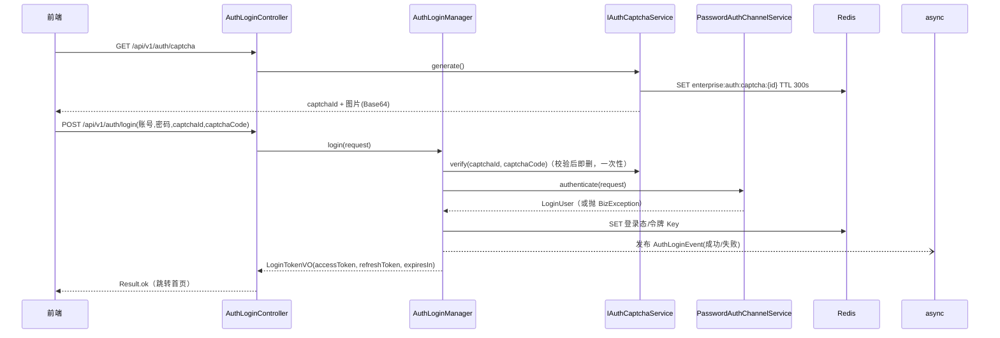
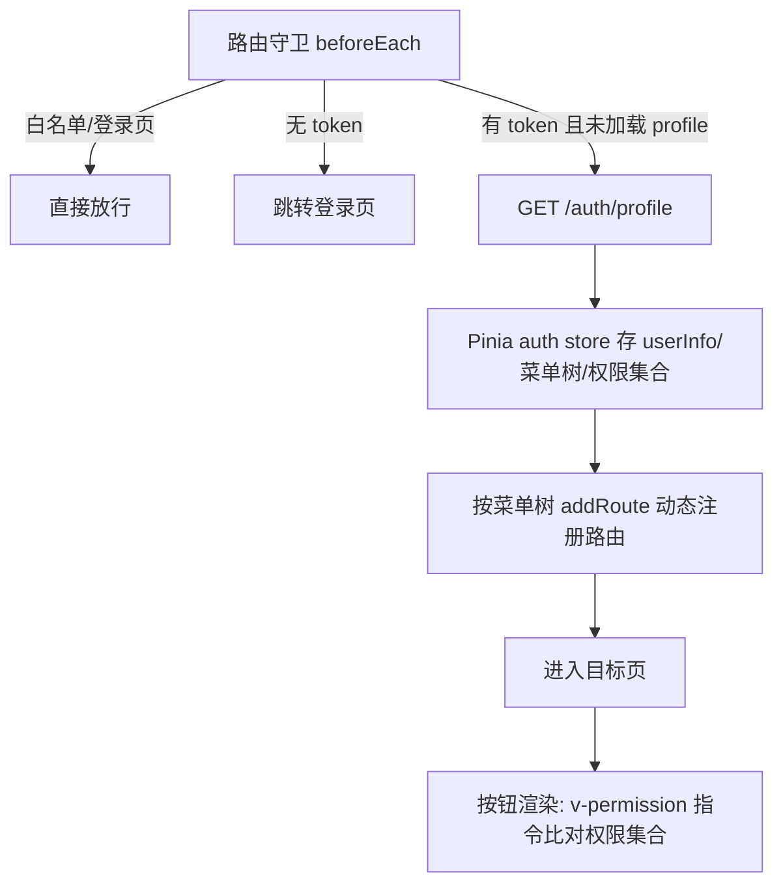
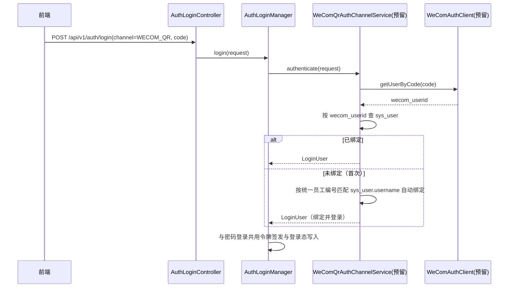

# cacch-enterprise-platform 权限管理体系设计文档

| 项 | 内容 |
|------|------|
| 文档版本 | v1.0 |
| 编写日期 | 2026-10-26 |
| 作者 | hongfu_zhou@cacch.com |
| 状态 | 待评审 |
| 关联需求文档 | [需求文档-权限管理体系](./需求文档-权限管理体系.md) |

## 修订记录

| 版本 | 日期 | 说明 | 作者 |
|------|------|------|------|
| v1.0 | 2026-10-26 | 首次发布 | hongfu_zhou@cacch.com |

---

## 1. 概述

本文档为权限管理体系的总体设计，覆盖：数据模型（含 Flyway 脚本）、登录认证设计（JWT 双令牌 + Redis 登录态）、RBAC 按钮级权限模型、数据权限拦截、REST 接口清单、前端权限方案，以及 iHR 同步与企微登录的扩展预留。

设计原则：

1. **登录渠道可插拔**：账号密码登录为本期唯一实现，企微扫码/自建应用免登通过渠道策略接口接入，核心编排不变；
2. **前端控制仅为展示层优化**：按钮显隐由前端处理，所有接口后端二次鉴权（`@PreAuthorize`）；
3. **权限变更实时生效**：权限数据与登录态分离缓存，授权变更仅失效权限缓存，不踢用户下线（对应 PRD 共享规则 R-4）；
4. **严格遵守项目分层与包路径规范**（`project_rules.md` 第三节）。

## 2. 总体架构

### 2.1 分层调用关系



- 事务入口：`ISysUserManager`、`ISysRoleManager` 等跨聚合编排方法（`@Transactional` 显式声明，仅覆盖 DB 写）；
- 单聚合 CRUD（部门、菜单）由 Controller 直接调用 Service；
- 登录链路无 DB 写操作，登录日志通过 Spring 事件异步落库。

### 2.2 新增类落位清单

| 模块 | 类 | 说明 |
|------|----|------|
| common | `constant.redis.RedisConstants` | Key 前缀 `enterprise:` |
| common | `constant.auth.AuthCommonConstants` / `AuthPathConstants` | auth 公共常量、PATH |
| common | `constant.system.SystemPermissionConstants` | 全部权限标识常量与 `perm()` 工具 |
| common | `config.auth.SecurityProperties` | `cacch.security.*` 配置（构造器绑定） |
| common | `result.ResultCode` 新增 auth/system 号段错误码 | 401xx 未登录/凭证失效/账号停用、403xx 无权限等 |
| dao | `entity.system.SysUserDO` / `SysRoleDO` / `SysMenuDO` / `SysDeptDO` / `SysUserRoleDO` / `SysRoleMenuDO` | 实体 |
| dao | `mapper.system.Sys*Mapper` | Mapper（继承 `BaseMapper`） |
| dao | `mybatis.DataPermissionInterceptor` | 数据权限拦截器（MyBatis-Plus `InnerInterceptor`） |
| service | `service.auth.api.IAuthCaptchaService` / `impl.AuthCaptchaServiceImpl` | 验证码生成与校验 |
| service | `service.auth.api.IAuthChannelService` / `impl.PasswordAuthChannelServiceImpl` | 登录渠道策略接口 + 账号密码实现 |
| service | `service.system.api.ISysUserService` 等五个接口及 impl | 用户/角色/菜单/部门/权限加载 |
| manager | `manager.auth.api.IAuthLoginManager` / `impl.AuthLoginManagerImpl` | 登录编排（渠道分派、令牌、事件发布） |
| manager | `manager.system.api.ISysUserManager` / `ISysRoleManager` / `impl.*` | 用户+角色分配、角色授权跨聚合编排 |
| integration | `integration.wecom.client.WeComAuthClient`（预留空实现位） | 企微身份源客户端（本期不实现） |
| async | `async.log.listener.LoginLogListener` | 登录事件异步写 `sys_login_log`（表由日志域脚本建，本期发布事件） |
| web | `controller.auth.AuthLoginController`；`controller.system.SysUserController` 等 4 个 | 接口层 |
| web | `convert.auth.AuthLoginConverter`；`convert.system.SysUserConverter` 等 | MapStruct 转换器 |
| web | `dto.auth.request.*` / `dto.auth.vo.*`；`dto.system.*` | 请求/响应对象 |
| web | `security.JwtTokenProvider` / `JwtAuthenticationFilter` / `RestAuthenticationEntryPoint` / `RestAccessDeniedHandler` | JWT 与 Security 基础设施 |
| web | `config.auth.SecurityConfiguration` / `AuthConfiguration` | Security 过滤链与配置注册 |

## 3. 数据模型

### 3.1 ER 关系



### 3.2 Flyway 规划

- 现有 [V1__init_schema.sql](../cacch-enterprise-web/src/main/resources/db/migration/V1__init_schema.sql) 为空占位（未建任何表），保持不动；
- 新增 `V2__permission_system.sql`：建 6 张表 + 初始化数据（内置角色、admin 用户、预置菜单树）；
- 脚本位置：`cacch-enterprise-web/src/main/resources/db/migration/`，仅 test 环境 Flyway 自动执行。

### 3.3 表结构设计（DDL 摘要）

通用约定：主键 `id BIGINT`（雪花，禁止自增）；标准字段 `create_time`/`update_time`/`create_by`/`update_by`/`deleted`（逻辑删除 0/1）；`status` 统一 0 正常 / 1 停用。唯一性用 **PostgreSQL 部分唯一索引**（`WHERE deleted = 0`）实现「逻辑删除后可复用」。

**sys_dept（部门）**

| 列 | 类型 | 说明 |
|----|------|------|
| parent_id | BIGINT NOT NULL DEFAULT 0 | 父部门，0 为根 |
| ancestors | VARCHAR(500) NOT NULL DEFAULT '' | 祖先链 `0,1001,1002`，供本部门及下级数据权限查询 |
| dept_name | VARCHAR(64) NOT NULL | 部门名称（同级唯一） |
| order_num | INT NOT NULL DEFAULT 0 | 排序 |
| leader_id | BIGINT | 负责人用户 ID |
| status | SMALLINT NOT NULL DEFAULT 0 | 0 正常 / 1 停用 |
| source | VARCHAR(32) NOT NULL DEFAULT 'LOCAL' | 数据来源：`LOCAL` / `IHR`（预留） |
| external_id | VARCHAR(64) | iHR 部门唯一编号（预留） |

约束：`UNIQUE(parent_id, dept_name) WHERE deleted = 0`；索引 `idx_dept_parent(parent_id)`。

**sys_user（用户）**

| 列 | 类型 | 说明 |
|----|------|------|
| username | VARCHAR(64) NOT NULL | 工号，登录账号之一 |
| phone | VARCHAR(20) NOT NULL | 手机号，登录账号之一 |
| password | VARCHAR(100) NOT NULL | BCrypt 密文（at.favre，cost 10） |
| real_name | VARCHAR(64) NOT NULL | 姓名 |
| dept_id | BIGINT | 归属部门 |
| status | SMALLINT NOT NULL DEFAULT 0 | 0 启用 / 1 停用 |
| source | VARCHAR(32) NOT NULL DEFAULT 'LOCAL' | `LOCAL` / `IHR`（预留） |
| external_id | VARCHAR(64) | iHR 人员唯一编号（预留） |
| wecom_userid | VARCHAR(64) | 企微 UserId（预留，扫码/免登绑定） |
| last_login_time | TIMESTAMP | 最近登录时间 |

约束：`UNIQUE(username) WHERE deleted = 0`、`UNIQUE(phone) WHERE deleted = 0`、`UNIQUE(wecom_userid) WHERE deleted = 0 AND wecom_userid IS NOT NULL`；索引 `idx_user_dept(dept_id)`。

**sys_role（角色）**

| 列 | 类型 | 说明 |
|----|------|------|
| role_code | VARCHAR(64) NOT NULL | 角色编码（唯一，创建后不可改） |
| role_name | VARCHAR(64) NOT NULL | 角色名称（唯一） |
| data_scope | SMALLINT NOT NULL DEFAULT 4 | 数据权限：1 全部 / 2 本部门 / 3 本部门及下级 / 4 仅本人 |
| built_in | SMALLINT NOT NULL DEFAULT 0 | 1 内置角色（保护） |
| status | SMALLINT NOT NULL DEFAULT 0 | 0 正常 / 1 停用 |
| remark | VARCHAR(255) | 备注 |

约束：`UNIQUE(role_code) WHERE deleted = 0`、`UNIQUE(role_name) WHERE deleted = 0`。

**sys_menu（菜单/按钮）**

| 列 | 类型 | 说明 |
|----|------|------|
| parent_id | BIGINT NOT NULL DEFAULT 0 | 父节点 |
| menu_name | VARCHAR(64) NOT NULL | 名称 |
| menu_type | VARCHAR(8) NOT NULL | `D` 目录 / `M` 菜单 / `B` 按钮 |
| order_num | INT NOT NULL DEFAULT 0 | 排序 |
| path | VARCHAR(128) | 前端路由地址（目录/菜单） |
| component | VARCHAR(255) | 前端组件路径（菜单） |
| perms | VARCHAR(128) | 权限标识（按钮必填，全局唯一） |
| icon | VARCHAR(64) | 图标 |
| visible | SMALLINT NOT NULL DEFAULT 0 | 0 显示 / 1 隐藏 |
| status | SMALLINT NOT NULL DEFAULT 0 | 0 正常 / 1 停用 |

约束：`UNIQUE(perms) WHERE deleted = 0 AND perms IS NOT NULL`；索引 `idx_menu_parent(parent_id)`。

**sys_user_role / sys_role_menu（关联表）**

均含 `id BIGINT` 主键 + 标准字段 + 业务外键列：

- `sys_user_role(user_id, role_id)`：`UNIQUE(user_id, role_id) WHERE deleted = 0`，索引 `idx_ur_user(user_id)`；
- `sys_role_menu(role_id, menu_id)`：`UNIQUE(role_id, menu_id) WHERE deleted = 0`，索引 `idx_rm_role(role_id)`。

关联变更策略：重新分配角色/重新授权时，对旧关联行做**逻辑删除**并插入新行（保留授权历史，便于审计回溯）。

### 3.4 初始化数据（V2 内，幂等写入 `ON CONFLICT DO NOTHING`）

1. **内置角色**：`SUPER_ADMIN`（data_scope=1, built_in=1）、`SYS_ADMIN`、`DEPT_ADMIN`（data_scope=3）、`AUDITOR`、`USER`（data_scope=4）；
2. **根部门**：`Cacch 总部`（source=LOCAL）；
3. **admin 用户**：`SUPER_ADMIN` 唯一持有者，username=`admin`，dept_id=根部门；初始密码为 `Admin@123456`（满足复杂度：≥8 位，含字母与数字），Flyway 脚本中以对应 BCrypt 密文写入——⚠️ **该明文仅为交付阶段临时记录，上线前须登录修改密码，并删除本行明文，避免进入 Git 历史**（PRD Q-10，已确认 2026-10-27）；
4. **预置菜单树**（内置，built-in 不可删除）：
   - `首页`（M，`/dashboard`，无 perms，所有登录用户可见）；
   - `系统管理`（D，`/system`）→ `用户管理`（M，`/system/users`）、`角色管理`（M，`/system/roles`）、`菜单管理`（M，`/system/menus`）、`部门管理`（M，`/system/depts`），各菜单下挂按钮（见 5.4 权限标识表）；
   - `个人中心`（M，`/profile`）+ `修改密码`按钮；
   - 角色授权初始化：`SYS_ADMIN` 授予系统管理全部菜单与按钮；`SUPER_ADMIN` 不落关联表（代码层全量放行，见 5.2）。

## 4. 认证设计

### 4.1 登录渠道抽象

登录编排与身份校验分离，渠道以策略接口扩展：

```java
// service.auth.api —— 渠道策略接口（每个登录渠道一个实现）
public interface IAuthChannelService {
    /** 渠道类型：PASSWORD / WECOM_QR / WECOM_INAPP（预留） */
    AuthChannelEnum channel();
    /** 渠道身份校验，成功返回登录用户上下文；失败抛 BizException */
    LoginUser authenticate(AuthLoginRequest request);
}
```

- 本期实现 `PasswordAuthChannelServiceImpl`：按输入格式识别账号类型（正则 `^1[3-9]\d{9}$` 判手机号，否则工号）→ 查 `sys_user`（`username` 或 `phone`，未删除）→ BCrypt 校验 → 状态检查 → 返回 `LoginUser(userId, username, realName, deptId, dataScope集合)`；
- 企微渠道实现（预留）：`WeComQrAuthChannelServiceImpl` / `WeComInappAuthChannelServiceImpl` 注入 `WeComAuthClient`，按 `wecom_userid` 反查用户，未绑定则返回绑定引导（PRD FR-06b/c）；
- `AuthLoginManagerImpl` 按 `channel()` 注入 `List<IAuthChannelService>` 路由，**新增渠道零改动核心编排**。

### 4.2 登录时序



失败路径：验证码错误 / 账号密码错误 / 账号停用，均抛 `BizException` 对应 401xx 错误码——账号不存在与密码错误统一返回 `AUTH_CREDENTIALS_INVALID`（防枚举），停用/删除明确返回 `AUTH_ACCOUNT_DISABLED`（PRD Q-2 已确认）。**登录链路无 DB 写操作，Redis 操作均在 Manager 层完成，不与数据库事务混合**。

### 4.3 JWT 双令牌

`JwtTokenProvider`（web.security，HS256，密钥 `cacch.security.jwt-secret`）：

| 项 | 设计 |
|----|------|
| access_token claims | `sub=userId`、`username`、`type=access`、`jti`、`iat`、`exp`；有效期 `accessTokenExpire=43200s`（12 小时） |
| refresh_token claims | 同上，`type=refresh`；有效期 `refreshTokenExpire=43200s`（12 小时；登录后 12 小时内可静默续期，超时须重新登录） |
| 敏感信息控制 | payload **不携带**权限集合与部门以下组织信息，权限走 Redis（4.4），避免改权限需换发令牌 |
| 配置绑定 | `SecurityProperties`（common.config.auth，构造器绑定）：`jwtSecret`、`accessTokenExpire`、`refreshTokenExpire`、`loginChannelPolicy` |

`SecurityProperties` 经 `config.auth.AuthConfiguration` 以 `@EnableConfigurationProperties` 注册，`loginChannelPolicy=KICK_OUT`（互踢，默认策略，PRD Q-4 已确认；预留 `COEXIST` 共存模式，本期仅实现 KICK_OUT）。

### 4.4 Redis Key 设计

| Key | 值 | TTL | 说明 |
|-----|----|-----|------|
| `enterprise:auth:token:{userId}` | `LoginUser` JSON（含当前会话 access jti） | refresh 剩余有效期，访问时滑动续期 | 登录态；`KICK_OUT` 策略下登录成功即覆盖（旧会话 jti 不匹配 → 401） |
| `enterprise:auth:refresh:{userId}` | 当前有效 refresh `jti` | 同 refresh 有效期 | 刷新轮换：换发后旧 jti 失效；登出/强制下线/重置密码时删除 |
| `enterprise:auth:captcha:{captchaId}` | 验证码文本 | 300s | 一次性，校验后即删 |
| `enterprise:auth:perms:{userId}` | `Set<String>` 权限标识 | 12h | **与登录态分离**；授权变更 evict（5.3） |
| `enterprise:auth:routes:{userId}` | 用户菜单树 JSON | 12h | 动态路由数据源；与 perms 同步 evict |

Key 组装方法按规范放 `AuthCommonConstants`（auth 域）与 `SystemCommonConstants`（权限缓存），基于 `RedisConstants.KEY_PREFIX`。

### 4.5 请求鉴权流程（JwtAuthenticationFilter）

1. 从 `Authorization: Bearer <token>` 解析 access_token，校验签名与 `exp`；
2. `type != access` 拒绝；比对 Redis 登录态存在且 jti 匹配（互踢/强制下线生效点）；
3. 从 `enterprise:auth:perms:{userId}` 加载权限集合（miss 时经 `ISysPermissionService` 回源重建并写缓存），注入 `SecurityContext` authorities；
4. Controller 方法上的 `@PreAuthorize("hasAuthority('system:user:add')")` 完成按钮级鉴权；
5. 未登录访问受保护资源 → `RestAuthenticationEntryPoint` 返回 401 业务码；权限不足 → `RestAccessDeniedHandler` 返回 403 业务码（PRD 8.1 越权防护）。

白名单（permitAll）：`/api/v1/auth/login`、`/api/v1/auth/captcha`、`/api/v1/auth/refresh`、健康检查、静态资源。

### 4.6 刷新、登出与强制下线

| 流程 | 设计 |
|------|------|
| 静默刷新 | `POST /api/v1/auth/refresh` 携带 refresh_token：校验签名/类型 → 比对 `enterprise:auth:refresh:{userId}` 中 jti 一致 → 签发新令牌对并轮换 jti（旧 refresh 立即失效，防重放） |
| 登出 | 删除 `token:{userId}`、`refresh:{userId}`（当前会话） |
| 强制下线 | 管理员操作 → 删除目标用户上述两 Key → 目标用户下次请求 401 |
| 重置密码/修改密码 | 删除目标用户 `token`/`refresh` **全部会话 Key（含当前会话）**；修改密码由前端在成功响应后清空本地令牌并返回登录页（PRD Q-6 已确认） |

## 5. 权限模型与鉴权

### 5.1 权限加载链（登录/回源）

```
ISysPermissionService.loadUserPerms(userId)
  → ISysRoleService.listRoleCodes(userId)           （启用状态角色）
  → ISysMenuService.listPermsByRoles(roleIds)       （status=0、type=B 的 perms 集合）
  → data_scope 集合随 LoginUser 返回，供数据权限拦截器使用
```

`SUPER_ADMIN` 不查关联表：`loadUserPerms` 识别 role_code 后直接返回全量权限标识 + 全量菜单树（对应 3.4 第 4 点，且天然满足「权限不可修改」）。

### 5.2 权限变更实时生效（PRD R-4 实现）

| 变更 | 失效动作 |
|------|----------|
| 角色授权变更（sys_role_menu） | 删除该角色**所有关联用户**的 `perms:`/`routes:` Key |
| 用户角色分配变更（sys_user_role） | 删除该用户两个缓存 Key |
| 菜单/按钮增删改 | 删除引用该菜单（含子按钮）的所有角色 → 上述角色关联用户的缓存 Key |

evict 由 Manager 在 DB 写事务**提交后**执行（`TransactionSynchronization.afterCommit`），避免缓存回源读到未提交数据；用户下次请求回源重建，不中断会话。

### 5.3 数据权限（MyBatis-Plus 拦截器）

- `DataPermissionInterceptor`（dao.mybatis，实现 `InnerInterceptor`）：解析 SQL，向目标表追加部门过滤条件，**禁止在 XML 手写部门 SQL**（规范 6.4）；
- 过滤值来自 `LoginUser.dataScopes`：
  - 全部 → 不追加条件；
  - 本部门 → `dept_id = {user.deptId}`；
  - 本部门及下级 → `dept_id IN (SELECT id FROM sys_dept WHERE id = {deptId} OR ancestors LIKE '{ancestors}%')`（依赖 3.3 ancestors 冗余链）；
  - 仅本人 → `create_by = {userId}`；
- 生效范围：以注解 `@DataScope(tableAlias = "u")` 标记的 Mapper 方法（用户列表、后续业务列表），避免影响登录查询等旁路 SQL；
- 多角色取**并集**（如同时拥有「本部门」与「仅本人」→ `OR` 合并）。

### 5.4 权限标识表（`SystemPermissionConstants` 常量化）

| 菜单 | 权限标识 |
|------|----------|
| 用户管理 | `system:user:list`、`system:user:add`、`system:user:edit`、`system:user:delete`、`system:user:status`、`system:user:resetPwd`、`system:user:offline` |
| 角色管理 | `system:role:list`、`system:role:add`、`system:role:edit`、`system:role:delete`、`system:role:grant` |
| 菜单管理 | `system:menu:list`、`system:menu:add`、`system:menu:edit`、`system:menu:delete` |
| 部门管理 | `system:dept:list`、`system:dept:add`、`system:dept:edit`、`system:dept:delete` |
| 个人中心 | `system:profile:resetPwd` |

规范：`{biz}:{资源}:{操作}`，全小写；Controller 注解引用常量（`@PreAuthorize("hasAuthority('" + SystemPermissionConstants.USER_ADD + "')")` 不支持拼接 → 采用自定义 `@RequiresPermission(SystemPermissionConstants.USER_ADD)` 注解 + 切面实现，常量编译期校验，避免魔法字符串）。

## 6. 接口设计

统一返回 `Result<T>`；鉴权方式标注权限标识（自定义 `@RequiresPermission`）。

### 6.1 认证接口（auth）

| 方法 | PATH | 鉴权 | 说明 |
|------|------|------|------|
| GET | `/api/v1/auth/captcha` | 匿名（限流） | 获取图形验证码（captchaId + Base64 图） |
| POST | `/api/v1/auth/login` | 匿名（限流） | 登录，返回双令牌 |
| POST | `/api/v1/auth/refresh` | 匿名（refresh_token） | 静默刷新令牌对 |
| POST | `/api/v1/auth/logout` | 登录用户 | 登出 |
| GET | `/api/v1/auth/profile` | 登录用户 | 当前用户信息 + 菜单树 + 权限标识集合（前端动态路由数据源） |
| PUT | `/api/v1/auth/profile/password` | 登录用户 | 修改密码（原密码校验） |

### 6.2 系统管理接口（system）

| 方法 | PATH | 权限标识 | 说明 |
|------|------|----------|------|
| GET | `/api/v1/system/users` | `system:user:list` | 分页查询（工号/姓名/手机号/部门/状态筛选，数据权限过滤） |
| POST | `/api/v1/system/users` | `system:user:add` | 新增用户（含角色分配，走 Manager） |
| PUT | `/api/v1/system/users/{id}` | `system:user:edit` | 编辑用户（工号不可改） |
| DELETE | `/api/v1/system/users/{id}` | `system:user:delete` | 逻辑删除 |
| PUT | `/api/v1/system/users/{id}/status` | `system:user:status` | 启用/停用 |
| PUT | `/api/v1/system/users/{id}/password` | `system:user:resetPwd` | 管理员重置密码 |
| GET | `/api/v1/system/users/online` | `system:user:offline` | 在线用户列表 |
| DELETE | `/api/v1/system/users/online/{userId}` | `system:user:offline` | 强制下线 |
| GET | `/api/v1/system/roles` | `system:role:list` | 分页查询 |
| POST | `/api/v1/system/roles` | `system:role:add` | 新增角色 |
| PUT | `/api/v1/system/roles/{id}` | `system:role:edit` | 编辑角色（含 data_scope） |
| DELETE | `/api/v1/system/roles/{id}` | `system:role:delete` | 逻辑删除（有用户关联则拒绝） |
| PUT | `/api/v1/system/roles/{id}/menus` | `system:role:grant` | 角色授权（菜单+按钮全量提交） |
| GET | `/api/v1/system/menus/tree` | `system:menu:list` | 菜单树 |
| POST/PUT/DELETE | `/api/v1/system/menus[/{id}]` | `system:menu:add/edit/delete` | 菜单维护（删除走 R-5 校验） |
| GET | `/api/v1/system/depts/tree` | `system:dept:list` | 部门树 |
| POST/PUT/DELETE | `/api/v1/system/depts[/{id}]` | `system:dept:add/edit/delete` | 部门维护 |

## 7. 前端权限方案（cacch-enterprise-ui）



1. **登录态**：Pinia `auth` store 持久化双令牌（localStorage）；请求拦截器自动附加 `Authorization`；
2. **静默续期**：响应拦截器捕获 401（access 过期）→ 以 refresh 换发重放原请求；refresh 失效 → 清空登录态跳登录页；
3. **动态路由**：仅注册 `profile` 返回且 `visible=0`、`status=0` 的菜单，未授权路由一律 404 兜底（不依赖前端隐藏做安全）；
4. **按钮指令**：`v-permission="'system:user:add'"`，无权限时移除元素；`hasPerm()` 组合式函数供逻辑分支使用；
5. **菜单渲染**：侧边栏由 `profile` 返回的菜单树驱动，`SUPER_ADMIN` 后端返回全量树。

## 8. 扩展设计（预留）

### 8.1 iHR 部门与人员同步

- **落位**：`integration.ihr.client.IhrApiClient`（+ `client.dto`）+ `integration.ihr.adapter.IhrOrgSyncAdapter`；同步任务 `async.system.task.DeptSyncTask` / `UserSyncTask`（`@Scheduled`，`async.{biz}.task`）；
- **幂等**：按 `source='IHR'` + `external_id` 定位记录，写入统一 `INSERT ... ON CONFLICT DO UPDATE`（PG12 兼容，禁止 MERGE）；
- **边界**：同步数据字段本地只读（PRD FR-06a [TBD] 项立项时明确）；同步失败逐条 try-catch 统计，不阻断批次；任务中 DB 写使用 `REQUIRES_NEW` 独立事务，不混 HTTP 调用。

### 8.2 企微登录



- 绑定字段：`sys_user.wecom_userid`（3.3 唯一索引已预留）；
- 绑定规则（PRD Q-9 已确认，2026-10-27）：企微员工编号与平台工号统一，首次登录按 `username = 企微员工编号` 自动匹配绑定，**绑定后不允许用户自助解绑**，仅当前企业可使用（无多企微身份）；匹配失败（数据不一致）时提示联系管理员处理；
- 企微身份获取失败、匹配失败等逻辑终止场景须打 INFO 日志说明原因；
- `WeComAuthClient` 实现时须遵守三方 Client 入参/出参 INFO 日志规范（`ThirdPartyHttpLogSupport` 脱敏），access_token 缓存 TTL 取 7000s（小于企微 7200s）；
- 自建应用免登复用同一渠道接口，仅 `channel()` 与 code 来源不同。

## 9. 安全与日志实现要点

| 项 | 实现 |
|----|------|
| 密码 | at.favre BCrypt（cost 10）；登录/重置/修改统一经 `PasswordAppSupport` 封装 |
| 限流 | `captcha`、`login` 接口 Redis 计数限流（同 IP 维度），超限返回 429 业务码 |
| 账号枚举 | 「账号不存在」「密码错误」统一映射同一错误码 `AUTH_CREDENTIALS_INVALID`；停用/删除明确返回「账号已被停用」（`AUTH_ACCOUNT_DISABLED`，PRD Q-2 已确认） |
| 留痕 | 登录成败/登出/强制下线/授权变更发布 Spring 事件，`async.log.listener` 异步落库，事件携带 traceId |
| 日志 | 业务层 `【Auth】`/`【SysUser】` 等中文方括号前缀；请求体与密码一律不落业务日志；逻辑终止（验证码失效、账号停用、企微身份匹配失败）打 INFO 说明原因 |
| 事务 | Manager 编排方法 `@Transactional(rollbackFor=Exception.class, propagation=REQUIRED, readOnly=false, timeout=30)`；纯读 Service `SUPPORTS + readOnly=true + timeout=10`；Redis 操作一律在事务边界外 |
| 审计脱敏 | 手机号中间四位掩码后入日志 |

## 10. 错误码规划（ResultCode 新增）

| 号段 | 错误码 | 场景 |
|------|--------|------|
| 401xx | `AUTH_CREDENTIALS_INVALID` | 账号或密码错误（含账号不存在） |
| 401xx | `AUTH_CAPTCHA_INVALID` | 验证码错误/过期 |
| 401xx | `AUTH_ACCOUNT_DISABLED` | 账号停用/删除（明确提示，PRD Q-2） |
| 401xx | `AUTH_TOKEN_EXPIRED` / `AUTH_TOKEN_INVALID` / `AUTH_KICKED_OUT` | 令牌过期 / 无效 / 被挤下线或强制下线 |
| 403xx | `AUTH_PERMISSION_DENIED` | 无按钮级权限 |
| 403xx | `SYSTEM_USER_PROTECTED` | SUPER_ADMIN 保护性操作拒绝 |
| 401xx | `SYSTEM_USERNAME_DUPLICATE` / `SYSTEM_PHONE_DUPLICATE` / `SYSTEM_ROLE_CODE_DUPLICATE` / `SYSTEM_PERMS_DUPLICATE` | 唯一性冲突 |
| 400xx | `SYSTEM_MENU_HAS_CHILDREN` / `SYSTEM_MENU_IN_USE` / `SYSTEM_ROLE_HAS_USERS` / `SYSTEM_DEPT_HAS_CHILDREN` / `SYSTEM_DEPT_HAS_USERS` | 删除校验拒绝 |
