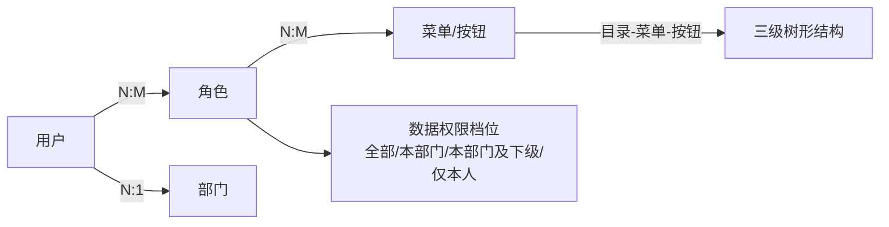

# cacch-enterprise-platform 权限管理体系需求文档（PRD）

| 项 | 内容 |
|------|------|
| 文档版本 | v1.0 |
| 编写日期 | 2026-10-26 |
| 作者 | hongfu_zhou@cacch.com |
| 状态 | 待评审 |
| 关联设计文档 | [设计文档-权限管理体系](./设计文档-权限管理体系.md) |

## 修订记录

| 版本 | 日期 | 说明 | 作者 |
|------|------|------|------|
| v1.0 | 2026-10-26 | 首次发布 | hongfu_zhou@cacch.com |

---

## 1. 背景与目标

### 1.1 背景与问题

cacch-enterprise-platform 是 Cacch 公司统一的企业管理后台基座，对内承载账号认证、组织架构、权限角色等基础能力，对外为各业务系统提供统一身份认证与用户组织数据来源。当前系统缺少统一的登录认证与权限管控能力：

- 员工尚无统一入口登录平台，账号身份无法与工号、手机号对应；
- 各功能页面缺乏统一的权限管控，无法做到「不同角色看到不同菜单、使用不同按钮」；
- 缺少部门组织数据支撑，无法表达「用户归属哪个部门」这一基本组织事实。

### 1.2 目标（可观察结果）

1. 员工可使用**工号**或**手机号**（配合密码）登录平台，两种身份等价，任一输入正确即可登录成功；
2. 管理员可将权限配置到**页面菜单**与**页面按钮**级别，普通用户登录后仅能看到被授权的菜单，仅能使用被授权的按钮；
3. 管理员可维护部门树并将用户归属到部门，数据权限可按「全部 / 本部门 / 本部门及下级 / 仅本人」控制；
4. 后续可平滑接入 **iHR 部门与人员同步**、**企业微信扫码登录**与**企微自建应用免登**，本期不实现对接，但身份与组织数据结构已为其预留。

## 2. 术语定义

| 术语 | 说明 |
|------|------|
| 工号 | 员工在企业内的唯一编号，作为登录账号之一，全局唯一 |
| 角色 | 一组权限（菜单、按钮）与一个数据范围的命名集合，用户通过被赋予角色获得权限 |
| 权限标识 | 描述一个可执行操作的字符串（如「新增用户」），按钮级控制的基本单元 |
| 数据权限 | 用户可见数据行的范围：全部 / 本部门 / 本部门及下级 / 仅本人 |
| 菜单 | 前端导航树中的节点，分为**目录**（分组）、**菜单**（页面）、**按钮**（页面内操作）三类 |
| 逻辑删除 | 记录被标记为已删除，不在任何列表中可见，但物理数据保留 |
| iHR | 公司人力资源系统，后续作为部门与人员数据的主数据来源 |
| 企微自建应用 | 公司在企业微信内自建的应用，用户在企微内打开时可免密登录平台 |

## 3. 用户与角色定义

| 角色编码 | 角色名称 | 职责 | 数据权限 | 内置说明 |
|----------|----------|------|----------|----------|
| `SUPER_ADMIN` | 超级管理员 | 平台最高权限持有者，拥有全部功能权限与数据权限 | 全部 | 内置角色，不可删除、不可停用，其他角色不可被授予超出其范围的能力 |
| `SYS_ADMIN` | 系统管理员 | 负责用户、角色、菜单权限、部门的日常管理 | 全部 | 内置角色 |
| `DEPT_ADMIN` | 部门管理员 | 负责本部门及下级部门人员的日常维护 | 本部门及下级 | 内置角色，具体能力边界见第 7.1 节权限矩阵 |
| `AUDITOR` | 审计员 | 查看操作日志、登录日志（只读） | 全部 | 内置角色；日志审计功能属「日志审计」业务域另行立项，本期仅预留该角色 |
| `USER` | 普通员工 | 登录平台访问工作台与个人中心 | 仅本人 | 内置角色；工作台功能另行立项，本期保证其可登录并访问默认页面 |

说明：

- 内置角色由系统初始化时预置，角色编码与名称不可修改，`SUPER_ADMIN` 权限不可修改；
- 业务上可新建自定义角色并为其勾选任意菜单与按钮权限。

## 4. 范围

### 4.1 本期范围（P0）

用户旅程闭环：管理员建部门 → 建用户（分配部门与角色）→ 建角色并授权菜单/按钮 → 用户用工号或手机号登录 → 仅看到授权范围内的菜单与按钮 → 管理员可维护与回收权限。

- **FR-01 登录认证**：账号密码登录、图形验证码、失败锁定、双令牌与续期、登出、修改密码
- **FR-02 用户管理**：用户增删改查、启停用、重置密码、在线用户与强制下线
- **FR-03 角色管理**：角色增删改查、菜单授权、数据权限档位设置
- **FR-04 菜单与按钮权限管理**：目录/菜单/按钮三级维护、权限标识管理
- **FR-05 部门管理**：部门树维护、用户归属

### 4.2 预留范围（P1，本期仅做结构与字段预留，不实现）

- **FR-06a iHR 同步**：部门与人员从 iHR 定期同步；
- **FR-06b 企微扫码登录**：员工在 PC 端扫码登录；
- **FR-06c 企微自建应用免登**：用户在企微内打开平台自动登录；
- 短信验证码登录（依赖短信服务，另行评估）。

### 4.3 排除项

- 操作日志、登录日志的查询页面（属「日志审计」业务域，另行立项；本期产生的登录、授权变更行为留痕见第 8.3 节）；
- 工作台、消息通知等业务功能页面。

### 4.4 完成证据与恢复路径

- **完成证据**：管理员完成上述闭环后，新建用户以其手机号登录成功，且页面仅显示该用户角色授权的菜单；未授权按钮不可见且后端拒绝对应操作。
- **最重要的恢复路径**：忘记密码 → 联系管理员重置密码后重新登录；连续输错密码被锁定 → 等待锁定期结束或由管理员重置密码解锁。

## 5. 核心产品模型

### 5.1 授权模型

- 一个用户可拥有多个角色，权限取并集；
- 一个角色可勾选菜单树上任意节点（含按钮），角色决定「能做什么」；
- 数据权限档位挂在角色上，决定「能看哪些数据行」；
- 用户必须归属一个部门（顶级管理员账号可例外，见 FR-02）。

### 5.2 登录模型

单一登录入口、单一账号输入框：用户输入**工号或手机号**之一（系统自动识别身份类型），配合密码与图形验证码登录。登录成功后获得访问凭证（短期有效，自动续期）与刷新凭证（长期有效）；登出或被强制下线后凭证立即失效。

## 6. 功能需求

### FR-01 登录认证

**目的**：让员工以工号或手机号安全登录平台，并防止暴力破解。

**触发**：任何未登录用户访问平台，前端跳转至登录页。

**处理规则**：

1. 登录表单包含：账号（工号或手机号）、密码、图形验证码。系统按输入格式自动识别账号类型（手机号格式按手机号查询，否则按工号查询），用户无需自行选择。
2. 密码校验失败、账号不存在、账号已停用、账号已删除，均返回**统一提示「账号或密码错误」**，不区分具体原因（防账号枚举）；账号停用/删除时提示「账号已被停用」。（[Assumption, TBD]：停用与删除是否也统一提示为「账号或密码错误」，见第 10 节）
3. 图形验证码：进入登录页即获取并展示；点击图片可刷新；验证码一次性有效，校验后（无论对错）即失效，有效期 5 分钟；验证码错误视同登录失败。
4. 防暴力破解：同一账号连续登录失败 **5 次**后锁定 **15 分钟**（[Assumption, TBD]），锁定期内即使密码正确也拒绝登录并提示剩余等待时间；锁定时间过后计数自动清零。登录成功后失败计数立即清零。
5. 登录成功：签发访问凭证与刷新凭证，页面跳转至用户首个可见菜单对应页面（或默认工作台占位页）。

**结果与状态变更**：

- 用户进入已登录状态；其最近登录时间被记录；
- 登录成功与失败行为均被记录（供后续日志审计域使用）。

**令牌与续期**：

| 项 | 规则 |
|----|------|
| 访问凭证有效期 | 默认 2 小时（[Assumption, TBD]，可配置） |
| 刷新凭证有效期 | 默认 7 天（[Assumption, TBD]，可配置） |
| 续期方式 | 访问凭证过期时，前端使用刷新凭证静默换取新凭证，用户无感知 |
| 刷新凭证失效 | 登出、被强制下线、或刷新凭证过期后，用户须重新登录 |

**多端登录策略**：同一账号重复登录时，默认**新登录挤掉旧会话**（旧会话操作时提示重新登录）。（[Assumption, TBD]：是否需支持多端共存，见第 10 节）

**登出**：用户主动登出后，该会话两枚凭证均立即失效。

**修改密码（个人中心）**：

- 触发：已登录用户在个人中心发起；
- 规则：须输入原密码校验通过；新密码须满足复杂度要求（长度 ≥ 8，须包含字母与数字，[Assumption, TBD]）；
- 结果：修改成功后**当前会话保持登录，其他会话全部下线**（[Assumption, TBD]）。

**异常与边界**：

| 场景 | 行为 |
|------|------|
| 验证码过期 | 提示「验证码已过期」，要求刷新后重试，本次不消耗密码尝试次数 |
| 账号被强制下线 | 该会话任何操作返回未登录，前端引导重新登录并提示「您的账号已在别处登录/被强制下线」 |
| 管理员重置密码 | 见 FR-02；重置后该用户所有会话下线 |

### FR-02 用户管理

**目的**：管理员维护平台账号及其部门归属与角色授权。

**触发**：具有用户管理权限的角色（`SUPER_ADMIN`、`SYS_ADMIN`；部门管理员按 7.1 节受限使用）进入「用户管理」页面。

**处理规则**：

1. **列表**：分页展示用户；支持按工号、姓名、手机号模糊搜索，按部门（含下级部门）、状态筛选；展示部门管理员可见范围内（其本人部门及下级）的用户。
2. **新增用户**：
   - 必填：工号（全局唯一）、手机号（全局唯一，11 位手机号格式）、姓名、归属部门、初始密码；
   - 可选：角色（可多选）、邮箱；
   - 提交成功后用户状态默认为「启用」。
3. **编辑用户**：可修改姓名、手机号、部门、角色、邮箱；**工号不可修改**。
4. **启用/停用**：停用后该用户立即无法使用系统（已有会话全部下线）；`SUPER_ADMIN` 不可被停用。
5. **重置密码**：管理员输入新密码（满足复杂度要求）或由系统生成随机密码；重置成功后该用户所有会话下线，须用新密码重新登录。
6. **删除**：逻辑删除，列表不再可见；`SUPER_ADMIN` 不可被删除；已删除用户的工号、手机号可被新用户重新使用。
7. **在线用户与强制下线**：可查看当前在线用户列表（登录时间、来源）；可对单个在线用户执行强制下线，被下线用户立即失去会话。
8. **数据来源标记**：用户数据来源默认为「本地创建」；为 iHR 同步预留来源标记，iHR 同步来的用户本地编辑受限于预留规则（见 FR-06a，本期不实现）。

**权限与数据范围**：

- `DEPT_ADMIN` 可见并可维护本部门及下级部门用户，但**不可删除用户、不可为用户分配角色**（[Assumption, TBD]，见第 10 节）；
- 所有用户管理操作仅作用于操作者数据范围内的用户，越界操作被后端拒绝。

**异常与边界**：工号或手机号已被占用时提示具体冲突字段；停用 `SUPER_ADMIN`、删除 `SUPER_ADMIN` 等保护性操作被拒绝并提示原因。

### FR-03 角色管理

**目的**：管理员定义角色并为其配置功能权限与数据权限。

**触发**：`SUPER_ADMIN`、`SYS_ADMIN` 进入「角色管理」页面。

**处理规则**：

1. **列表**：分页展示角色（编码、名称、状态、是否内置、数据权限档位、创建时间）；支持按名称/编码搜索。
2. **新增/编辑角色**：
   - 必填：角色编码（全局唯一，创建后不可修改，大写字母+下划线）、角色名称（唯一）；
   - 可选：备注、状态。
3. **菜单授权**：以菜单树（目录/菜单/按钮三级，含复选框）为角色勾选权限；勾选保存后，拥有该角色的用户按新权限展示菜单与按钮。授权变更后**受影响用户刷新页面即生效**（详见共享规则 R-4）。
4. **数据权限档位**：为角色设置 全部 / 本部门 / 本部门及下级 / 仅本人 四档之一。
5. **删除**：逻辑删除；**角色已分配用户时禁止删除**，须先解除用户关联；内置角色不可删除。
6. **保护规则**：`SUPER_ADMIN` 的权限范围与数据档位不可修改；内置角色的编码与名称不可修改。

**结果与状态变更**：授权/变更操作立即持久化，并触发受影响用户的权限刷新（R-4）。

### FR-04 菜单与按钮权限管理

**目的**：管理员维护平台菜单树与按钮级权限标识，作为所有角色授权的依据。

**触发**：`SUPER_ADMIN`、`SYS_ADMIN` 进入「菜单管理」页面。

**处理规则**：

1. 菜单树以**目录 → 菜单 → 按钮**三级组织；页面以树形展示并支持展开/收起。
2. **目录**：名称、图标、排序、路由地址；**菜单**：名称、路由地址、前端组件、图标、排序、是否可见；**按钮**：名称、**权限标识（必填）**、归属菜单、排序。
3. 权限标识全局唯一，命名规范见设计文档（形如 `模块:资源:操作`），由系统管理菜单的维护者保证与前端按钮、后端接口一一对应。
4. **删除校验**：存在子节点时禁止删除；已被任何角色关联时禁止删除（须先在角色管理中取消授权）。
5. 系统预置菜单（登录后首页、系统管理域各页面及其按钮）由系统初始化提供，可编辑、不可删除（内置标记）。
6. 菜单与按钮的增删改遵循共享规则 R-4 生效机制。

**异常与边界**：权限标识重复时保存被拒绝；排序值冲突时按保存顺序自然排列。

### FR-05 部门管理

**目的**：管理员维护组织部门树，作为用户归属与数据权限计算的基础。

**触发**：`SUPER_ADMIN`、`SYS_ADMIN` 进入「部门管理」页面。

**处理规则**：

1. 部门以树形结构展示，支持多级嵌套；展示部门名称、负责人、状态、排序。
2. **新增/编辑**：名称（同级唯一）、上级部门（新增时必选，根节点除外）、负责人（可选，从用户中选择）、排序、状态。
3. **停用部门**：停用后不可再向该部门（含下级）新增用户，已有用户不受影响。
4. **删除**：逻辑删除；存在子部门或存在归属用户时禁止删除。
5. **数据来源标记**：部门数据来源默认为「本地维护」；为 iHR 同步预留来源标记与外部唯一编号（本期不实现同步，见 FR-06a）。

### FR-06 扩展预留（本期不实现）

**FR-06a iHR 同步预留**

- 后续部门与人员将以 iHR 为主数据源定期同步至平台，本地仍可创建数据；
- 本期在部门与用户数据上预留「数据来源」与「外部唯一编号」两个字段；
- 同步来的数据与本地手工数据的编辑边界（如 iHR 用户是否允许本地改手机号）**[TBD]**，将在同步需求立项时明确。

**FR-06b 企微扫码登录预留**

- 预期流程：PC 登录页展示企微二维码 → 员工扫码确认 → 首次扫码须**绑定本地账号**（输入工号/手机号 + 密码验证后建立绑定关系）→ 后续扫码直接登录；
- 本期在用户数据上预留企微身份字段；登录方式以可扩展方式设计（新增登录渠道不影响既有账号密码登录）。

**FR-06c 企微自建应用免登预留**

- 预期流程：用户在企业微信内打开平台应用 → 平台通过企微免登机制获取其企微身份 → 匹配已绑定账号后自动登录，未绑定则引导走 FR-06b 绑定流程。

## 7. 共享规则

### R-1 角色功能权限矩阵（唯一权威定义）

| 功能/操作 | SUPER_ADMIN | SYS_ADMIN | DEPT_ADMIN | AUDITOR | USER |
|-----------|:----:|:----:|:----:|:----:|:----:|
| 登录 | ✓ | ✓ | ✓ | ✓ | ✓ |
| 用户-查看 | ✓ | ✓ | ✓（本部门及下级） | — | — |
| 用户-新增/编辑/启停 | ✓ | ✓ | ✓（本部门及下级） | — | — |
| 用户-重置密码 | ✓ | ✓ | ✓（本部门及下级） | — | — |
| 用户-删除 | ✓ | ✓ | — | — | — |
| 用户-分配角色 | ✓ | ✓ | — | — | — |
| 用户-在线查看/强制下线 | ✓ | ✓ | — | — | — |
| 角色-全部管理（含授权） | ✓ | ✓ | — | — | — |
| 菜单-全部管理 | ✓ | ✓ | — | — | — |
| 部门-全部管理 | ✓ | ✓ | — | — | — |
| 个人中心-修改密码 | ✓ | ✓ | ✓ | ✓ | ✓ |
| 日志-查看（预留） | ✓ | — | — | ✓ | — |

- 「—」表示该角色不展示对应菜单且后端拒绝对应操作；
- 自定义角色的能力由授权勾选决定，但任何角色（含自定义）都不可修改、停用或删除 `SUPER_ADMIN` 账号与内置角色。

### R-2 数据权限档位（唯一权威定义）

| 档位 | 含义 | 适用示例 |
|------|------|----------|
| 全部 | 平台全部数据 | SUPER_ADMIN、SYS_ADMIN |
| 本部门 | 仅用户所属部门的数据 | — |
| 本部门及下级 | 所属部门及全部子部门的数据 | DEPT_ADMIN |
| 仅本人 | 仅用户本人产生的数据 | USER |

### R-3 唯一性与保护规则汇总

| 对象 | 唯一性 | 保护规则 |
|------|--------|----------|
| 用户工号 | 全局唯一（逻辑删除后可复用） | 不可修改；SUPER_ADMIN 不可编辑/停用/删除 |
| 用户手机号 | 全局唯一（逻辑删除后可复用） | 可修改，修改后须重新校验唯一 |
| 角色编码 | 全局唯一 | 创建后不可修改；内置角色不可删除 |
| 角色名称 | 全局唯一 | 内置角色名称不可修改 |
| 权限标识 | 全局唯一 | 内置菜单不可删除 |
| 部门名称 | 同级唯一 | 有子部门或用户时不可删除 |

### R-4 权限变更生效机制

管理员对角色授权、菜单、用户角色的任何变更，持久化成功后即触发受影响用户的权限缓存刷新；**受影响用户刷新页面或进行下一次操作时即按新权限展示与鉴权**，无需重新登录。（技术实现见设计文档 5.3 节）

### R-5 逻辑删除规则

用户、角色、菜单、部门均采用逻辑删除：删除后所有列表与选择器不可见、不可被授权引用；其历史留痕数据保留。唯一性约束在「未删除」范围内生效（即工号删除后可被新用户复用）。

## 8. 非功能需求

### 8.1 安全

| 项 | 要求 |
|----|------|
| 密码存储 | 不可逆加密存储，任何界面与日志不得出现明文密码 |
| 登录防护 | 图形验证码 + 连续失败锁定（见 FR-01），登录接口有限流防护 |
| 会话安全 | 凭证短期有效并支持续期；登出/强制下线/密码重置后旧凭证立即失效 |
| 越权防护 | 所有按钮级操作后端二次鉴权，前端隐藏按钮仅作为展示层优化，不作为安全手段 |
| 数据越界防护 | 所有列表与操作按操作者数据权限档位过滤，越界请求后端拒绝 |
| 账号枚举防护 | 登录失败统一提示，不暴露账号是否存在 |

### 8.2 性能

| 项 | 要求 |
|----|------|
| 登录响应 | 登录接口在正常负载下 2 秒内返回 |
| 权限加载 | 登录后进入首页期间完成菜单渲染，权限校验不产生可感知延迟（权限数据有缓存） |
| 列表分页 | 用户/角色列表均分页返回，单页默认 10 条，可切换 |

### 8.3 审计留痕

以下行为须被记录（供日志审计域查询，本期仅保证记录产生）：登录成功、登录失败（含账号与失败原因分类）、登出、强制下线、用户增删改与启停用、重置密码、修改密码、角色增删改、角色授权变更、菜单变更、部门增删改、用户角色分配变更。留痕内容包含操作者、操作时间、操作对象，**不包含明文密码**。

## 9. 验收标准

| 编号 | 验收项 |
|------|--------|
| AC-01 | 分别使用工号+密码、手机号+密码登录同一账号均成功；密码错误、验证码错误、停用账号登录均被拒绝且提示符合 FR-01 |
| AC-02 | 同一账号连续失败 5 次后被锁定，锁定期内正确密码也无法登录，等待期后可登录 |
| AC-03 | 访问凭证过期后前端自动续期，用户操作不中断；登出后旧凭证立即失效 |
| AC-04 | 新建用户并授予含按钮权限的角色后，该用户登录仅见授权菜单，点击未授权按钮不可见；直接调用未授权接口被后端拒绝 |
| AC-05 | SYS_ADMIN 创建部门→用户→角色并完成授权的闭环可走通；未授权用户的菜单树中不出现系统管理 |
| AC-06 | 工号/手机号重复创建被拒绝并提示冲突字段；SUPER_ADMIN 的编辑、停用、删除操作被拒绝 |
| AC-07 | DEPT_ADMIN 仅能看到并维护本部门及下级部门用户，且界面不提供删除与角色分配能力，直接调用对应接口被拒绝 |
| AC-08 | 角色授权变更后，受影响用户刷新页面即按新权限展示；回收某按钮权限后，该用户操作立即被拒绝 |
| AC-09 | 有子部门或归属用户的部门无法删除；有子节点或被角色引用的菜单无法删除；有用户的角色无法删除 |
| AC-10 | 在线用户列表可见登录会话，强制下线后目标用户下一次操作即要求重新登录 |
| AC-11 | 管理员重置密码后，被重置用户所有会话下线，新密码可登录 |
| AC-12 | 用户与部门数据包含数据来源与外部编号字段（iHR 预留）、用户包含企微身份字段（企微预留），且登录渠道扩展点已在代码结构中体现 |

## 10. 假设与待确认项

| 编号 | 事项 | 当前取值 | 状态 |
|------|------|----------|------|
| Q-1 | 登录失败锁定阈值与时长 | 5 次 / 15 分钟 | [Assumption, TBD]，待安全策略确认 |
| Q-2 | 停用/删除账号的登录提示是否与密码错误统一 | 区分提示「账号已被停用」 | [Assumption, TBD] |
| Q-3 | 双令牌有效期 | 2 小时 / 7 天，可配置 | [Assumption, TBD] |
| Q-4 | 多端登录策略 | 默认互踢（新登录挤掉旧会话） | [Assumption, TBD]，如需多端共存须明确设备数上限 |
| Q-5 | 密码复杂度 | ≥ 8 位，含字母与数字 | [Assumption, TBD] |
| Q-6 | 修改密码后其他会话处理 | 其他会话全部下线，当前会话保留 | [Assumption, TBD] |
| Q-7 | DEPT_ADMIN 能力边界 | 不可删除用户、不可分配角色 | [Assumption, TBD] |
| Q-8 | iHR 同步周期、字段映射与冲突策略 | 未定 | [TBD]，同步需求立项时明确 |
| Q-9 | 企微账号绑定策略（是否允许自助解绑、一人多企微身份） | 首次扫码密码验证绑定 | [TBD] |
| Q-10 | 初始 SUPER_ADMIN 账号（admin）的初始密码交付方式 | 部署时由实施人员设置，不以明文入库 | [Assumption, TBD] |
